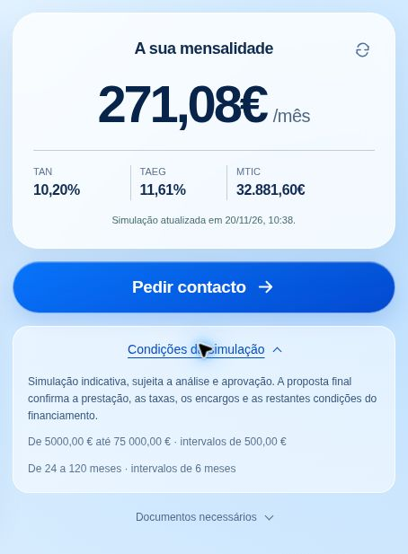

# Condições da simulação — verificação

Versão publicada em 20 de novembro de 2026: b66283155bc1064595c0e9229e443349704415e9 (PR #50).

- GitHub Pages concluído com sucesso.
- Smoke existente de 15 cenários passou, sem envio real de mensagens.
- Secção de condições aberta na página publicada: bloco de referência e ligação externa ausentes.
- Nomes de financeiras ausentes do texto apresentado.
- Consulta de exemplo de 20.000 € a 120 meses continua a apresentar 271,08 €.

