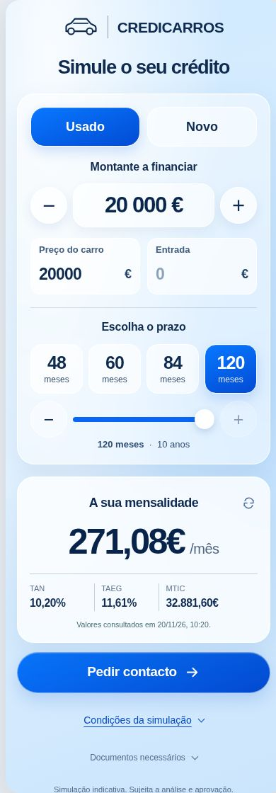
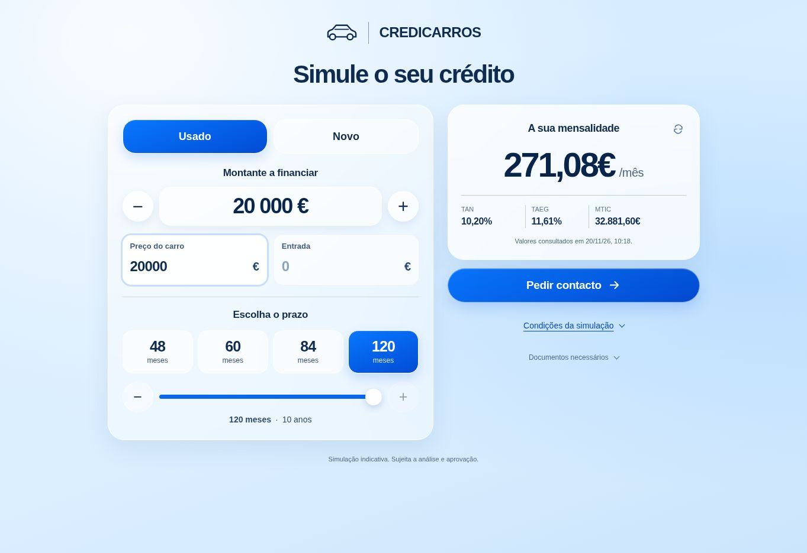

# Verificação do layout Vidro azul

Data: 20 de novembro de 2026.
Versão publicada: c3db66bfa550816841d473dfbe6e843864deab0f (PR #49).
Página: https://xroger1969.github.io/CREDICARROS/

## Resultado

- GitHub Pages: publicação concluída com sucesso.
- 17 testes do adaptador e dos endpoints passaram.
- Smoke offline de 15 cenários passou; zero mensagens reais enviadas.
- Comparação do core financeiro confirmou apenas as duas alterações de apresentação documentadas no PR.
- Interface observada em Chrome, desktop e iframe com larguras de 360 e 390 px; o espaço útil foi respetivamente 345 e 375 px devido à barra de deslocamento. Não é um teste em hardware iOS.
- Sem deslocamento horizontal. Controlos principais com pelo menos 52 px de altura.
- Janela de contacto abre e fecha, mostra a prestação válida e mantém o consentimento existente.
- Montante incompatível 22.990 € limpa o resultado e apresenta ajuste explícito de entrada.
- A prestação de 3.442,34 € e o MTIC de 123.306,00 € cabem no ecrã estreito.

## Consultas verificadas na interface

| Produto | Montante | Prazo | Prestação | TAN | TAEG | MTIC |
| --- | --- | --- | --- | --- | --- | --- |
| Usado | 20.000 € | 120 meses | 271,08 € | 10,20% | 11,61% | 32.881,60 € |
| Usado | 15.000 € | 84 meses | 252,13 € | 10,00% | 11,55% | 21.442,92 € |
| Novo | 20.000 € | 72 meses | 366,70 € | 9,25% | 10,77% | 26.754,40 € |

As consultas são indicativas e correspondem à data da verificação.

## Capturas da página publicada

